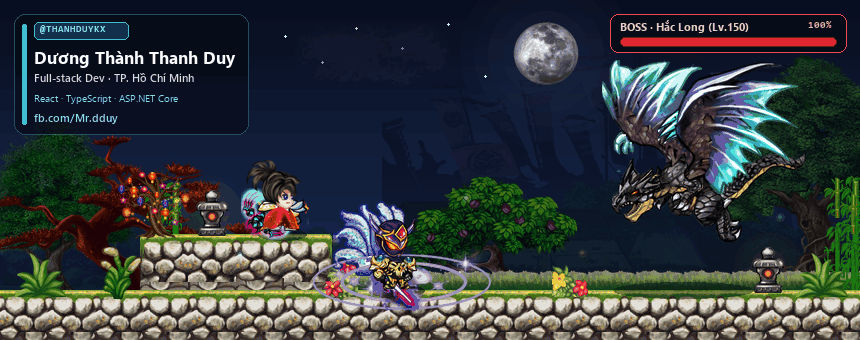

<picture>
  <source media="(prefers-reduced-motion: reduce)" srcset="./assets/nso-player-poster.png">
  
</picture>

Mình phát triển ứng dụng web với **React, TypeScript và ASP.NET Core**, từ giao diện tương tác đến API và cơ sở dữ liệu.

**Vị trí:** TP. Hồ Chí Minh · **Facebook:** [facebook.com/Mr.dduy](https://www.facebook.com/Mr.dduy)

## Dự án nổi bật

**[Homeji](https://github.com/fogit-hd/EXE101_Homeji)** ([Backend](https://github.com/thanhduykx/Homeji_BE)) · React, TypeScript, ASP.NET Core, PostgreSQL
