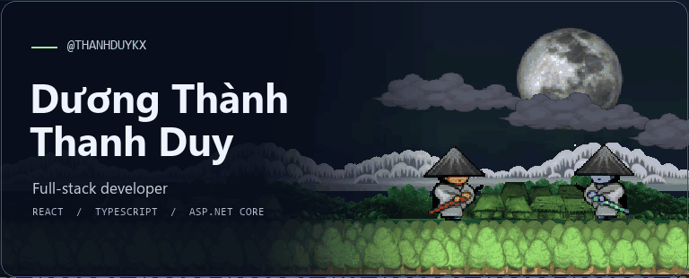

<picture>
  <source media="(prefers-reduced-motion: reduce)" srcset="./assets/nso-sprites-poster.png">
  
</picture>

Mình phát triển ứng dụng web với **React, TypeScript và ASP.NET Core**, từ giao diện tương tác đến API và cơ sở dữ liệu.

## Dự án nổi bật

**[Homeji](https://github.com/fogit-hd/EXE101_Homeji)** · React, TypeScript, ASP.NET Core, PostgreSQL  
Dự án nhóm kết nối người thuê với chủ trọ. Người dùng có thể tìm phòng trên bản đồ, tìm bạn ở ghép và đăng tin. [Xem backend](https://github.com/thanhduykx/Homeji_BE).

**[Liquid Glass Button](https://github.com/thanhduykx/liquid-glass-button)** · TypeScript, WebGL2  
Thành phần giao diện mô phỏng khúc xạ qua kính và phản hồi theo chuyển động con trỏ.

**[Love Space Đông Sơn](https://github.com/thanhduykx/love-space-dongson)** · Three.js, Node.js  
Không gian lưu ảnh và video gia đình với mô hình mặt trống đồng Đông Sơn 3D có thể tương tác.
